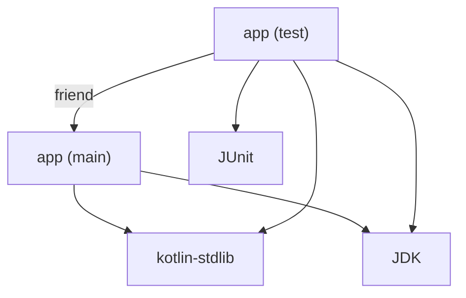

# Project Structure in Standalone

!!! note
    Experimental API. Subject to changes.

In the [Standalone mode](Standalone.md), your tool describes the project to analyze: its source files, libraries, and
the dependencies between them. This page covers the API for it.

If you have not read [Why you need to describe the project](Standalone.md#why-you-need-to-describe-the-project) yet,
start there.

## Modules

The Analysis API sees a project as a set of *modules*. A module is represented by a
[`KaModule`](../api/analysis-api/org.jetbrains.kotlin.analysis.api.projectStructure/-ka-module/index.md).
In the Standalone mode, you can create modules of the following kinds:

| Module kind             | What it represents                                                    | Builder function             |
|-------------------------|-----------------------------------------------------------------------|------------------------------|
| `KaSourceModule`        | Kotlin and Java source files that are compiled together               | `buildKtSourceModule`        |
| `KaLibraryModule`       | A compiled library: JAR files, class directories, or KLIBs            | `buildKtLibraryModule`       |
| `KaLibraryModule` (SDK) | A JDK                                                                 | `buildKtSdkModule`           |
| `KaLibrarySourceModule` | Sources of a library, such as a `-sources.jar`                        | `buildKtLibrarySourceModule` |
| `KaScriptModule`        | A single Kotlin script (`.kts`) file                                  | `buildKtScriptModule`        |

A `KaSourceModule` corresponds to what the Kotlin compiler compiles in one run. In Gradle terms, it is a source set
of a project rather than the whole project. E.g., from the Analysis API standpoint, `main` and `test` are two different
modules.

Modules form a graph. For a simple JVM application with tests, it may look like this:



## Declaring modules

Modules are declared inside the `buildKtModuleProvider {}` block of the session builder:

```kotlin
val session = buildStandaloneAnalysisAPISession {
    buildKtModuleProvider {
        platform = JvmPlatforms.defaultJvmPlatform

        val stdlib = addModule(
            buildKtLibraryModule {
                libraryName = "kotlin-stdlib"
                platform = JvmPlatforms.defaultJvmPlatform
                addBinaryRoot(stdlibJar)
            }
        )

        addModule(
            buildKtSourceModule {
                moduleName = "app"
                platform = JvmPlatforms.defaultJvmPlatform
                addSourceRoot(sourceRoot)
                addRegularDependency(stdlib)
            }
        )
    }
}
```

There are three things to remember:

1. Register every module with `addModule()`. A `build...` function only creates a module. The session does not know
   about it until it is registered. `addModule()` returns the passed module, so the calls can be combined.
2. Create a module before the modules that depend on it. Modules are immutable, and a dependency is passed as an already
   built `KaModule`. For a multi-module project, build the modules in the dependency order.
3. Call `buildKtModuleProvider {}` once. A second call replaces the result of the first one.

The block itself is
a [`KaModuleContainerBuilder`](../api/analysis-api-standalone/org.jetbrains.kotlin.analysis.project.structure.builder/-ka-module-container-builder/index.md)
with the following members:

`var platform: TargetPlatform`
: The default platform of the project. Required. See [Platforms](#platforms).

`fun <M : KaModule> addModule(module: M): M`
: Registers a module in the session.

## Common module options

All module builders share the following members:

`var platform: TargetPlatform`
: The platform the module is compiled for. Required for each module.

`fun addRegularDependency(module: KaModule)`
: Adds a dependency on another module. See [Dependencies](#dependencies).

`fun addFriendDependency(module: KaModule)`
: Adds a dependency that also gives access to `internal` declarations.

`fun addDependsOnDependency(module: KaModule)`
: Adds a Kotlin Multiplatform `dependsOn` dependency.

### Platforms

A `TargetPlatform` tells the Analysis API which declarations are available for the module, and which platform-specific
rules to apply. Use one of the predefined values:

| Platform        | Value                                      |
|-----------------|--------------------------------------------|
| JVM             | `JvmPlatforms.defaultJvmPlatform`, or `JvmPlatforms.jvmPlatformByTargetVersion(JvmTarget.JVM_17)` |
| Common (shared multiplatform code) | `CommonPlatforms.defaultCommonPlatform` |
| JS              | `JsPlatforms.defaultJsPlatform`            |
| Native          | `NativePlatforms.unspecifiedNativePlatform` |
| Wasm            | `WasmPlatforms.unspecifiedWasmPlatform`    |

!!! warning
    Currently, only `JvmPlatforms` is available on the compilation classpath of the `kotlin-analysis-api` artifact.
    The other platform classes are a part of its implementation, which is a runtime-only dependency. To use them,
    add the implementation artifact to the compilation classpath explicitly:

    ```kotlin
    dependencies {
        implementation("org.jetbrains.kotlin:kotlin-analysis-api:<version>")
        compileOnly("org.jetbrains.kotlin:kotlin-analysis-api-implementation:<version>")
    }
    ```

    Other classes in the implementation artifact are internal, and may change in any release.

### Dependencies

A module only sees declarations from itself and from its dependencies. There are three kinds of dependencies:

- A **regular** dependency makes public declarations of the other module visible. Use it for libraries, the JDK,
  and other source modules.
- A **friend** dependency also makes `internal` declarations visible. Use it for the dependency of a test source
  module on the production one.
- A **`dependsOn`** dependency connects source sets of a Kotlin Multiplatform project. A module can provide `actual`
  declarations for `expect` declarations of the module it depends on. See
  [Multiplatform projects](#multiplatform-projects).

Dependencies are not transitive. If module `app` depends on `core`, and `core` depends on a library, add the library to
the dependencies of `app` as well, as long as `app` is compiled against it. This matches the compilation classpath of
the module in a build system.

## Source modules

`buildKtSourceModule {}` creates a `KaSourceModule`. The block is
a [`KtSourceModuleBuilder`](../api/analysis-api-standalone/org.jetbrains.kotlin.analysis.project.structure.builder/-kt-source-module-builder/index.md):

`var moduleName: String`
: The name of the module. Required. The Kotlin compiler uses the module name in names of `internal` declarations
in the bytecode, so pass the same name as the build system does if you care about them.

`fun addSourceRoot(path: Path)`<br>`fun addSourceRoots(paths: Collection<Path>)`
: Adds source files. A path is either a directory or a single file. Directories are searched recursively
for `.kt`, `.kts`, and `.java` files.

`var languageVersionSettings: LanguageVersionSettings`
: The language version, the API version, and enabled language features. By default, it is the latest stable language
version. See [Language settings](#language-settings).

`fun addSourceVirtualFile(virtualFile: VirtualFile)`<br>`fun addSourceVirtualFiles(virtualFiles: Collection<VirtualFile>)`
: Adds source files that are not on disk. See [Files that are not on disk](#files-that-are-not-on-disk).

Java files in source roots are analyzed together with Kotlin files, so Kotlin code can refer to Java declarations from
the same module.

### Language settings

By default, a source module uses the latest stable Kotlin language version. To analyze the code in the same way as the
compiler does, pass the versions from the build configuration:

```kotlin
buildKtSourceModule {
    languageVersionSettings = LanguageVersionSettingsImpl(
        languageVersion = LanguageVersion.KOTLIN_2_2,
        apiVersion = ApiVersion.KOTLIN_2_2,
    )
    // ...
}
```

`LanguageVersion.fromVersionString("2.2")` and `ApiVersion.parse("2.2")` convert the values of the
`-language-version` and `-api-version` compiler options.

`LanguageVersionSettingsImpl` also accepts a map of language features to enable or disable individually, similar
to the `-XXLanguage` compiler option.

## Library modules

`buildKtLibraryModule {}` creates a `KaLibraryModule`. The block is
a [`KtLibraryModuleBuilder`](../api/analysis-api-standalone/org.jetbrains.kotlin.analysis.project.structure.builder/-kt-library-module-builder/index.md):

`var libraryName: String`
: The name of the library. Required. It is only used for display purposes.

`fun addBinaryRoot(root: Path)`<br>`fun addBinaryRoots(roots: Collection<Path>)`
: Adds compiled files of the library. A root can be a JAR file, a directory with `.class` files, or a KLIB.

`var librarySources: KaLibrarySourceModule?`
: Sources of the library, if available.

A library module can hold a single library or many of them. There are two common approaches:

- One module for the whole classpath. This is the simplest option, and it works well when you only analyze source code.
  The example in [Getting started](Standalone.md#create-a-session) uses it.
- One module per library. Use it if your tool needs to know which library a declaration comes from. For a symbol, the
  containing module is available as `symbol.containingModule`.

### JDK

For JVM modules, the JDK is simply one more library.
`buildKtSdkModule {}` creates a library module from a JDK installation:

```kotlin
val jdk = buildKtSdkModule {
    libraryName = "JDK"
    platform = JvmPlatforms.defaultJvmPlatform
    addBinaryRootsFromJdkHome(Path(System.getProperty("java.home")), isJre = false)
}
```

`addBinaryRootsFromJdkHome` accepts the JDK home directory. In the example, it is the JDK the tool itself runs on.
To analyze code against the JDK configured in the build, pass the path to that JDK instead.

Without the JDK module, references to Java classes such as `java.io.File` are unresolved.

## Multiplatform projects

In a Kotlin Multiplatform project, each source set becomes a separate source module with its own platform. Shared
source sets use the common platform, and are connected to platform-specific ones with `dependsOn` dependencies.

The example uses `CommonPlatforms`, which requires an [additional dependency](#platforms).

```kotlin
buildKtModuleProvider {
    platform = CommonPlatforms.defaultCommonPlatform

    val commonLibraries = addModule(
        buildKtLibraryModule {
            libraryName = "common libraries"
            platform = CommonPlatforms.defaultCommonPlatform
            addBinaryRoots(commonClasspath)
        }
    )

    val jvmLibraries = addModule(
        buildKtLibraryModule {
            libraryName = "JVM libraries"
            platform = JvmPlatforms.defaultJvmPlatform
            addBinaryRoots(jvmClasspath)
        }
    )

    val commonMain = addModule(
        buildKtSourceModule {
            moduleName = "commonMain"
            platform = CommonPlatforms.defaultCommonPlatform
            addSourceRoot(projectDir.resolve("src/commonMain/kotlin"))
            addRegularDependency(commonLibraries)
        }
    )

    val jvmMain = addModule(
        buildKtSourceModule {
            moduleName = "jvmMain"
            platform = JvmPlatforms.defaultJvmPlatform
            addSourceRoot(projectDir.resolve("src/jvmMain/kotlin"))
            addRegularDependency(jvmLibraries)
            addDependsOnDependency(commonMain)
        }
    )
}
```

With this setup, analyzing a file from `jvmMain` resolves `expect` declarations from `commonMain` to their `actual`
counterparts.

For multiplatform modules, also enable the `MultiPlatformProjects` language feature in the
[language settings](#language-settings):

```kotlin
languageVersionSettings = LanguageVersionSettingsImpl(
    languageVersion = LanguageVersion.LATEST_STABLE,
    apiVersion = ApiVersion.LATEST_STABLE,
    specificFeatures = mapOf(
        LanguageFeature.MultiPlatformProjects to LanguageFeature.State.ENABLED,
    ),
)
```

## Using the modules

The created session gives access to the registered modules:

`val modulesWithFiles: Map<KaSourceModule, List<PsiFile>>`
: Source modules together with their files, both Kotlin and Java.

`val allModules: List<KaModule>`
: All registered modules, including libraries.

Most of the time, you take a `KtFile` from `modulesWithFiles` and pass it to `analyze {}`. The Analysis API then
analyzes the file from the point of view of its module.

It is also possible to pass a module to `analyze {}` directly. This is useful when there is no source file to start
from. For example, the following code looks up a class from a library by its name:

```kotlin
analyze(sourceModule) {
    val listSymbol = findClass(ClassId.fromString("kotlin/collections/List"))
}
```

A file that does not belong to any registered module can still be analyzed. However, it does not see any libraries,
not even the Kotlin standard library. If you get unexpected unresolved references in each file, check that the source
module is registered and that its source roots are correct.

## Files that are not on disk

Source and library modules can also be built from `VirtualFile`s, the IntelliJ Platform abstraction of a file in some
file system. Use `addSourceVirtualFile()` and `addBinaryVirtualFile()` when the files are in memory or in a custom
file system.

For a more common task of analyzing a piece of code generated by your tool, there is no need to change the project
structure. Create an in-memory file with `KtPsiFactory(session.project)` and attach it to an existing module, as
described in [In-memory file analysis](In-memory-file-analysis.md).